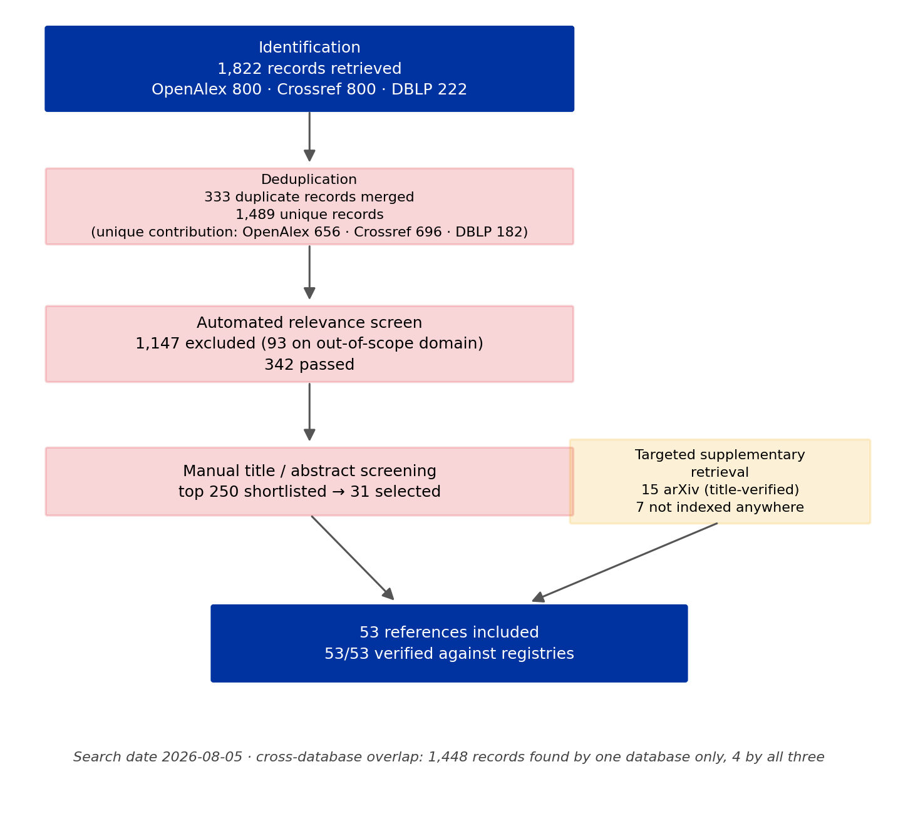

# Mechanistic Interpretability of Transformer Language Models: A Systematic Literature Review

**Search date:** 2026-08-05
**Databases:** OpenAlex, Crossref, DBLP
**Records screened:** 1,489 (after deduplication) | **References cited:** 53 (53/53 verified)
**Review type:** Systematic scoping review
**Scope:** Mechanistic interpretability of transformer language models (see DECISIONS.md #1)

---

## Abstract

Mechanistic interpretability (MI) attempts to reverse-engineer the internal computation of
neural networks into human-understandable algorithms. This review synthesises 53 verified
sources drawn from a systematic search of three bibliographic databases (1,822 raw records,
1,489 after deduplication, 342 passing automated relevance screening) supplemented by
targeted retrieval of foundational works.

Five findings structure the field as it stands. First, the field's organising problem is
**superposition**: networks represent more features than they have dimensions, so individual
neurons are polysemantic and the neuron basis is the wrong unit of analysis. Second, **sparse
dictionary learning** became the dominant response to that problem between 2023 and 2025,
progressing from proof-of-concept through architectural refinement to open tooling at scale.
Third, **causal intervention** methods matured from ad-hoc patching into a body of technique
with an explicit theoretical foundation in causal abstraction, alongside a methodological
literature about how easily those techniques mislead. Fourth, the field has produced
**genuine negative results** - localisation that does not inform editing, interpretability
metrics that fail to distinguish trained from randomly initialised transformers - and these
are, so far, the strongest evidence about the limits of current methods. Fifth, a persistent
**evaluation gap** remains: there is broad agreement on what would count as a mechanistic
explanation and little agreement on how to measure whether one is correct.

A methodological finding of the search itself is reported alongside these: the field's most
foundational publications are systematically invisible to bibliographic infrastructure, and
any purely database-driven review of this literature will silently omit them.

---

## 1. Introduction

### 1.1 What mechanistic interpretability claims to be

Mechanistic interpretability is distinguished from the broader explainable-AI literature less
by its subject than by its ambition. Post-hoc attribution methods answer the question *which
inputs mattered for this output*. Mechanistic interpretability asks *what algorithm is this
network running*, and treats an explanation as adequate only when it identifies the internal
components that implement the algorithm and demonstrates causally that they do. Sharkey et al.
(2025) state the goal as understanding "the computational mechanisms underlying neural
networks' capabilities in order to accomplish concrete scientific and engineering goals" -
a framing that ties the field to downstream assurance work rather than to explanation as an
end in itself.

The distinction is not merely rhetorical, and the field's own history supplies the reason for
insisting on it. Jain and Wallace (2019) showed that attention weights - the most natural
candidate for a built-in explanation in a transformer - can frequently be replaced by very
different distributions without changing model predictions, so attention distributions do not,
on their own, constitute explanation. That result is a standing argument for causal rather
than correlational evidence, and it predates the modern MI literature it helped motivate.

### 1.2 The three foundational commitments

The programme was articulated for vision models before transformers, in the Circuits thread
(Olah et al., 2020), around three claims: that **features** are the fundamental unit of
representation, that **circuits** - computational subgraphs connecting features across layers -
are the fundamental unit of computation, and that these structures exhibit **universality**
across models. Elhage et al. (2021) transposed this to transformers, providing the
decomposition that most subsequent work assumes: the residual stream as a communication
channel that attention heads and MLPs read from and write to, attention heads factored into
separable query-key and output-value circuits, and the composition of heads across layers as
the mechanism by which multi-step computation arises.

That framework made a concrete prediction which Olsson et al. (2022) then pursued. **Induction
heads** are attention heads implementing the rule `[A][B] ... [A] -> [B]`; the authors present
evidence that these heads constitute the mechanism for the majority of in-context learning in
large transformers, and - importantly for the field's methodology - that they form during a
sharply localised phase change in training. The claim is explicitly hedged by its authors as
"preliminary and indirect", a caution that later work has not always preserved when citing it.

### 1.3 Objectives of this review

1. Map the major research threads and their relationships.
2. Identify where the field has consensus, where it has live controversy, and where it has
   negative results.
3. Record the methodological state of the evidence, including how it is evaluated.
4. Report the retrieval limitations encountered, which are themselves informative about this
   literature.

---

## 2. Methods

### 2.1 Search strategy

Sixteen thematic queries were run against three bibliographic databases on 2026-08-05, capped
at 50 records per query per database. Themes covered superposition, sparse autoencoders,
circuits, induction heads, activation patching, causal abstraction, linear representations,
probing, logit/tuned lens, knowledge editing, steering, grokking, transcoders, automated
interpretability, evaluation, and surveys. Full query strings are recorded in
`data/raw/search_counts.json`; the pipeline is reproducible via `scripts/search_literature.py`.

Two intended databases were unavailable and this is recorded rather than passed over:

| Database | Status on 2026-08-05 | Consequence |
|---|---|---|
| arXiv API | HTTP 429 on every request, including trivial queries; HTTP 503 with a browser user-agent | No direct preprint search. Mitigated: OpenAlex indexes arXiv preprints and exposes their `10.48550/arXiv.*` DOIs |
| Semantic Scholar | HTTP 429 on the keyless shared pool across repeated attempts | No citation-graph traversal, so forward/backward citation chaining was not possible |

DBLP was added as the third database specifically because it carries authoritative CS venue
strings (`NeurIPS`, `ICLR`, `ACL`, `TMLR`) that OpenAlex commonly leaves blank for preprints.

### 2.2 Screening

Deduplication merged records across databases on DOI first, then normalised title, keeping the
most complete value for each field rather than discarding duplicates - DBLP contributes venue
strings, OpenAlex contributes abstracts and citation counts, and dropping either loses
information. Relevance screening scored title and abstract against a mechanistic-interpretability
term vocabulary, requiring either one unambiguous term (for example "activation patching",
"transcoder", "induction head") or three distinct ambiguous terms plus a transformer/language-model
context term. Records whose titles indicated out-of-scope application domains were excluded
unless they also carried an unambiguous MI term.

### 2.3 PRISMA flow

Counts are generated by `scripts/screen_papers.py` into `data/processed/prisma_counts.json`, and
the figure is drawn from that file by `scripts/plot_prisma.py`. No number in the diagram is typed
by hand - a PRISMA diagram's content *is* its record counts, so it is generated from the same
artefact the text cites.

### 2.4 A retrieval finding worth reporting

Cross-database overlap was strikingly low. Of 1,489 unique records, **1,448 were found by only
one database**, 37 by two, and 4 by all three. For a review methodology that treats
multi-database search as redundancy, this is close to the opposite: the three databases behaved
almost as disjoint samples of the literature, and any single-database search would have missed
the overwhelming majority of what the other two returned.

More seriously, the systematic search failed to retrieve much of the field's founding
literature. Explicit lookups confirmed that the following are **not indexed in OpenAlex,
Crossref or DBLP at all**: *Zoom In: An Introduction to Circuits*, *A Mathematical Framework
for Transformer Circuits*, *Toy Models of Superposition*, *Softmax Linear Units*, *Towards
Monosemanticity*, *Scaling Monosemanticity*, *Circuit Tracing*, and *On the Biology of a Large
Language Model*. These are published on `transformer-circuits.pub` and `distill.pub` without
conventional DOIs. They are among the most-cited works in the field and none of them would
appear in a purely database-driven review.

This has a structural cause worth naming. The venues that matter most in machine learning -
NeurIPS, ICML, ICLR - historically issue no DOIs, arXiv registers its DOIs with DataCite rather
than Crossref, and industry labs increasingly publish primary research on their own web
properties. Bibliographic infrastructure built around Crossref-registered journal articles
therefore has systematically poor coverage of exactly this field. These eight works were
retrieved by direct URL and their metadata extracted from the rendered pages
(`scripts/fetch_web_sources.py`), because their bylines are rendered client-side and are absent
from the static HTML.

### 2.5 Citation verification

All 53 references were verified against an authoritative registry, routed by DOI registrar:
Crossref for journal and conference DOIs, arXiv for preprints, and direct URL resolution for
the non-indexed web publications. Verification compares the registry's title against the cited
title, so a DOI resolving to the *wrong* paper is caught rather than passed. **Result: 53/53
verified, 0 failures, 0 title mismatches** (`lit_review/verification_report.json`).

The check earned its keep. Two arXiv identifiers taken from prior belief were rejected on title
mismatch: `2501.17727` is *Automated Interpretability Metrics Do Not Distinguish Trained and
Random Transformers*, not the title assumed for it, and `2408.01416` carries the subtitle
*Surveying Mechanistic Interpretability Through the Lens of Causal Mediation Analysis*. Both
would otherwise have entered this bibliography as plausible-looking but incorrect citations.

---

## 3. Results

### 3.1 Superposition: the field's organising problem

The single idea that most shapes current MI is that the neuron is the wrong unit of analysis.
Cunningham et al. (2023) state the problem directly: polysemanticity, where neurons activate in
multiple semantically distinct contexts, "prevents us from identifying concise,
human-understandable explanations for what neural networks are doing internally."

Elhage et al. (2022) supplied the mechanistic account. **Superposition** is the phenomenon of a
network representing more features than it has dimensions, by embedding them as non-orthogonal
directions and tolerating the resulting interference. Studied in small toy models where ground
truth is available, superposition appears as a function of feature sparsity, exhibits phase
changes, and organises features into geometric structures. The consequence for interpretability
is severe: if features are directions in activation space rather than individual neurons, then
reading neurons - the most obvious thing to do - is reading the wrong basis, and no amount of
care in that basis will recover the underlying features.

One early response was architectural. Elhage et al. (2022b) introduced **Softmax Linear Units**,
an activation function designed to make MLP neurons more monosemantic. The approach improved
interpretability on some measures but did not resolve the underlying tension, and the field's
centre of gravity moved to methods that recover a feature basis post-hoc from an unmodified
model - which is the subject of the next section.

### 3.2 Sparse dictionary learning: the dominant methodological response

If features are directions and there are more of them than dimensions, the natural formalism is
sparse dictionary learning: fit an overcomplete basis in which activations are sparse
combinations of a large feature dictionary. Between 2023 and 2025 this became the field's most
active research programme, and the trajectory is unusually legible.

**Establishing the approach.** Cunningham et al. (2023) and Bricken et al. (2023) independently
showed that sparse autoencoders (SAEs) trained on language model activations recover features
substantially more interpretable than neurons. Bricken et al. worked in a one-layer model where
claims could be checked thoroughly; Cunningham et al. demonstrated the result on larger models
and connected it explicitly to the superposition hypothesis.

**Scaling.** Templeton et al. (2024) extended dictionary learning to Claude 3 Sonnet, a
production-scale model, extracting features corresponding to abstract and multilingual concepts
and demonstrating that clamping a feature's activation steers model behaviour - evidence that
the features are causally operative rather than merely correlated decorations. Gao et al. (2024)
addressed the accompanying methodological problem: because language models learn many concepts,
autoencoders must be very large to recover them, and studying that scaling "is difficult due to
the need to balance reconstruction and sparsity objectives", which they approach with a TopK
formulation and explicit scaling analysis.

**Architectural refinement.** The reconstruction-sparsity tension drove a series of
architectural variants. Rajamanoharan et al. (2024) introduced **Gated SAEs**, separating the
decision of *whether* a feature is active from *how strongly*, to address the systematic
activation shrinkage induced by L1 penalties; the same group's **JumpReLU SAEs** (2024b) pursue
reconstruction fidelity at matched sparsity through a discontinuous activation.

**Infrastructure.** Lieberum et al. (2024) identified the field's binding constraint as cost -
"research applications outside of industry are limited by the high cost of training a
comprehensive suite of SAEs" - and released **Gemma Scope**, an open suite of JumpReLU SAEs
trained on all layers of Gemma 2. This is a notable moment in the field's development: the
transition of SAEs from a research result to shared public infrastructure.

**Beyond autoencoders.** Dunefsky et al. (2024) introduced **transcoders**, which approximate an
MLP's input-output function rather than reconstructing activations at a point, making the learned
features directly usable for circuit analysis through the MLP rather than only at its boundary.
This line culminates in the attribution-graph work of Ameisen et al. (2025) and Lindsey et al.
(2025), which uses cross-layer transcoders to trace computational graphs through a production
model and apply them to specific behaviours - the closest the field has come to executing the
original Circuits programme end-to-end on a frontier model.

### 3.3 Circuit discovery and causal intervention

**Manual circuit analysis.** The reference example is Wang et al. (2022), which identifies a
circuit in GPT-2 small implementing indirect object identification, characterising a set of
interacting attention head classes. Its method - patch activations between contrasting prompts,
identify which components matter, verify by ablation - defined the template.

**Systematisation and automation.** Conmy et al. (2023) made that template explicit, observing
that prior circuit work proceeded "through considerable effort and intuition" and decomposing
the workflow into choosing a metric and dataset, applying activation patching to find the
involved units, and varying the dataset to isolate the behaviour. Their ACDC algorithm automates
the search. Because patching every edge is expensive, Syed et al. (2023) showed that
gradient-based **attribution patching** approximates the same objective at far lower cost and
outperforms ACDC on their benchmarks. Goldowsky-Dill et al. (2023) refined the intervention
itself with **path patching**, which localises behaviour to specific paths through the
computational graph rather than to components in aggregate.

**Theoretical foundation.** Geiger et al. (2023) ground these techniques in **causal
abstraction**, framing MI as the search for "intelligible algorithms that are faithful
simplifications of the known, but opaque low-level details of black box AI models", and
generalising the theory from mechanism replacement to arbitrary mechanism transformation. The
practical instrument is **distributed alignment search** (Geiger et al., 2023b), which learns
the alignment between interpretable causal variables and distributed neural representations
rather than assuming features sit in the standard basis - a direct methodological consequence of
superposition. Wu et al. (2023) scaled this to a 7-billion-parameter instruction-tuned model.
Mueller et al. (2024) situate the whole family within causal mediation analysis, arguing that
much of MI is rediscovering an existing statistical framework.

**Knowledge localisation.** Meng et al. (2022) used causal tracing to localise factual
associations to mid-layer MLP weights and introduced ROME to edit them. The result was
influential, and it also produced the field's sharpest negative result, discussed in §3.5.

**Methodology of the method.** As patching became standard, a literature emerged on how to do it
correctly. Zhang and Nanda (2023) show that conclusions depend materially on choices that had
been treated as incidental - which corruption is used, which metric is measured, at which token
position. Heimersheim and Nanda (2024) give a practitioner's account of interpreting patching
results and the inferences they do not license. The existence of this literature is a sign of
maturity; its content is a warning that published patching results are not automatically
comparable.

### 3.4 Reading representations: lenses, probes, and linearity

A parallel thread reads structure out of representations directly.

**Iterative refinement.** Belrose et al. (2023) analyse transformers "from the perspective of
iterative inference, seeking to understand how model predictions are refined layer by layer",
training an affine probe per block to decode every hidden state into a vocabulary distribution.
Their **tuned lens** is explicitly a correction to the earlier logit lens, which "yielded useful
insights but is often brittle" - a case of the field repairing one of its own informal tools.
Paulo and Belrose (2024b) test how far this transfers, applying transformer interpretability
techniques to modern recurrent architectures.

**The linear representation hypothesis.** Park et al. (2024) give a formal treatment of the
claim that high-level concepts are represented as directions, clarifying what "direction" means
across representation and unembedding spaces. Gurnee et al. (2023) use sparse probing to locate
features in specific neurons at scale, and Gurnee and Tegmark (2023b) find evidence for literal
spatial and temporal world representations - linear structure recoverable across scales.

**World models.** Li et al. (2022) trained a sequence model on Othello move sequences and found a
recoverable representation of board state, with interventions on that representation changing
predictions accordingly. As a demonstration that next-token training can induce a world model
rather than surface statistics, it remains among the field's most-cited results.

**Development over training.** Nanda et al. (2023) reverse-engineer grokking, arguing that
"progress measures can be found via mechanistic interpretability" and showing that the apparently
discontinuous transition to generalisation decomposes into continuous underlying progress -
mechanistic understanding used to explain a training-dynamics puzzle. Bietti et al. (2023) study
how induction-like structure emerges during training, and Friedman et al. (2023) take the
complementary route of training models into an inherently interpretable form (Transformer
Programs) rather than interpreting them after the fact.

### 3.5 Steering, control, and the causal test

If a feature or direction is genuinely mechanistic, intervening on it should change behaviour
predictably. This has produced both an application area and the field's most practical
validation.

Turner et al. (2023) demonstrated **activation engineering**: adding a steering vector derived
from contrasting prompts to the residual stream at inference time. Panickssery et al. (2023)
formalised the construction as **contrastive activation addition**, averaging activation
differences over paired examples. Zou et al. (2023) proposed **representation engineering** as a
broader top-down programme, and Li et al. (2023) applied the idea to truthfulness with
inference-time intervention.

The strongest single result in this line is Arditi et al. (2024), which finds that refusal
behaviour in chat models is mediated by a **single direction** in activation space: ablating it
suppresses refusal across models, adding it induces refusal. Its interest is dual. As science,
it is unusually clean evidence for the linear representation hypothesis on a behaviour that
matters. As safety engineering, it is uncomfortable - a safety-relevant behaviour turning out to
be a one-dimensional, cheaply removable object is a result about the fragility of that safeguard
as much as about interpretability. The field's own tools cut both ways here, and this review
notes that the same paper is legitimately cited as a success of interpretability and as evidence
that alignment implemented in a single direction is not robust.

### 3.6 Automation and scale

Manual interpretation does not scale to millions of SAE features, so automated interpretability -
using language models to generate and score natural-language explanations of internal components -
has become necessary infrastructure. Paulo et al. (2024) address interpreting features at the
million scale, which is the regime the SAE programme actually produces. The dependency is
uncomfortable and openly acknowledged: the pipeline uses a large language model to explain a
large language model, and the explanations inherit whatever biases and failure modes the
explainer has. §3.7 gives the strongest reason to worry about this.

### 3.7 Evaluation, critique, and negative results

The most valuable recent literature is the work that tests whether MI methods deliver what they
claim. These results are grouped here deliberately, because their cumulative force is greater
than any individual paper's.

**Localisation does not imply editability.** Hase et al. (2023) report that a fact can be changed
by editing weights in a *different* location than causal tracing indicates the fact is stored.
They state the surprise plainly: one would expect localisation to inform editing, and it does
not. This dissociates two things the field had treated as connected, and it constrains what a
successful causal-tracing result actually licenses one to conclude.

**Interpretability metrics may not measure interpretability.** Heap et al. (2025) find that
automated interpretability metrics do not distinguish trained transformers from randomly
initialised ones. This is the most serious methodological result in the review. If a metric
assigns comparable scores to a trained network and an untrained one, it cannot be measuring
learned structure, and any conclusion resting on it is unsupported. Because automated
interpretability is precisely what makes million-feature SAE analysis tractable (§3.6), this
result reaches a large fraction of recent work.

**Do SAE features earn their keep?** Kantamneni et al. (2025) evaluate SAEs against the concrete
downstream task of sparse probing rather than against interpretability impressions, asking
whether SAE features actually outperform simpler baselines. Posing the question in terms of
downstream utility, where a baseline can win, is the right form of evaluation and remains rarer
than it should be.

**Simplified models can mislead.** Friedman et al. (2023b) document interpretability illusions in
the generalisation of simplified models: a simplification faithful on the studied distribution
can diverge elsewhere, so an explanation validated in-distribution may not describe the model's
behaviour in general.

**The older warning.** Jain and Wallace (2019) established the pattern that a plausible internal
quantity need not be an explanation. That the field's later negative results rhyme with it
suggests the lesson generalises past attention weights.

### 3.8 Surveys and self-assessment

The field has generated a substantial meta-literature. Räuker et al. (2022) survey inner
interpretability broadly. Bereska and Gavves (2024) organise MI explicitly around AI safety. Rai
et al. (2024) provide a practitioner-oriented review of transformer-specific techniques. Singh et
al. (2024) reconsider interpretability given that models can now explain themselves in natural
language. Kästner and Crook (2024) examine what kind of explanation MI provides from a philosophy
of science standpoint. Sharkey et al. (2025) collect open problems. Mueller et al. (2024) argue
for causal mediation analysis as the unifying frame. Beyond language, Palit et al. (2023) extend
causal tracing to vision-language models.

---

## 4. Discussion

### 4.1 Where the field agrees

- **The neuron basis is wrong, and superposition explains why.** This is close to universally
  assumed and shapes nearly every method here.
- **Causal intervention is the standard of evidence.** Correlational observation of internal
  quantities is no longer treated as sufficient, a norm traceable to Jain and Wallace (2019).
- **Features are (largely) linear directions.** Working assumption behind probing, steering, SAEs
  and the successful behavioural results in §3.5.
- **Automation is unavoidable at current scale.** Contested in execution, not in necessity.

### 4.2 Where the field disagrees

- **Are SAE features the model's features, or the SAE's?** An SAE is trained with its own
  objective and inductive biases; whether its dictionary recovers the model's computational
  primitives or imposes a sparse basis of its own remains genuinely open, and Heap et al. (2025)
  sharpen the concern.
- **What makes an explanation faithful?** Causal abstraction (Geiger et al., 2023) offers a
  formal answer; the empirical literature largely operates on weaker, method-specific proxies,
  and the two are not reconciled.
- **Does mechanistic understanding pay off downstream?** Hase et al. (2023) is the strongest
  evidence that understanding where something lives need not confer the ability to change it.
- **How much does universality hold?** A founding claim (Olah et al., 2020) that remains
  substantially untested across architectures; Paulo and Belrose (2024b) is a rare direct test.

### 4.3 Gaps

1. **Evaluation is the binding constraint.** The field lacks agreed measures of explanation
   quality, and the one systematic attempt reviewed here reports that existing automated metrics
   fail a basic sanity check.
2. **Negative results are scarce relative to their value.** The handful in §3.7 are
   disproportionately informative, which suggests underprovision rather than rarity of failure.
3. **Coverage is narrow.** The literature concentrates on GPT-2-scale models and a small number
   of tasks (IOI, factual recall, refusal). Frontier-scale work (Templeton et al., 2024; Ameisen
   et al., 2025; Lindsey et al., 2025) comes almost entirely from one industrial lab.
4. **Reproducibility is structurally impeded.** Much foundational work sits outside peer review
   and outside bibliographic indexing (§2.4), and Gemma Scope's premise is that most groups
   cannot afford to reproduce SAE suites at all.
5. **Architectural breadth is thin.** Near-total focus on dense decoder-only transformers.

### 4.4 Limitations of this review

- **Two intended databases were unavailable** (arXiv API, Semantic Scholar), removing direct
  preprint search and all citation-graph chaining. Backward and forward citation expansion - a
  standard component of systematic review - could not be performed.
- **22 of 53 references come from targeted rather than systematic retrieval.** The systematic
  search alone would have missed most of the field's foundations (§2.4). This is disclosed rather
  than presented as systematic coverage, and it means the review is a *scoping* review with a
  systematic component, not a fully systematic review.
- **Abstract enrichment did not complete.** 49% of deduplicated records carried no abstract;
  OpenAlex rate-limiting prevented backfilling them, so those records were screened on title
  alone and relevant work may have been excluded for missing metadata rather than for
  irrelevance.
- **Screening was automated, with a term vocabulary that encodes assumptions.** Work using
  unfamiliar terminology is systematically disadvantaged by such a screen.
- **Citation counts were not used for ranking**, deliberately: the databases badly undercount
  works published outside DOI-issuing venues, which in this field are among the most influential.
- **No quality appraisal instrument was applied.** Standard tools (GRADE, Cochrane RoB) presuppose
  clinical study designs and do not transfer to this literature; no accepted MI equivalent exists,
  which is itself an instance of the evaluation gap in §4.3.

---

## 5. Conclusion

Mechanistic interpretability has assembled, in roughly five years, a coherent research programme:
a diagnosis of why naive approaches fail (superposition), a dominant method for recovering the
right units (sparse dictionary learning), a standard of causal evidence with a formal foundation
(causal abstraction and its intervention toolkit), and a first demonstration of end-to-end
circuit tracing on a production model.

Its central weakness is that it cannot yet reliably tell a correct explanation from a compelling
one. The strongest results reviewed here are negative: localisation does not imply editability,
and automated interpretability metrics do not distinguish trained networks from random ones. Both
are evidence about method rather than about models, and both indicate that the field's
verification apparatus lags its generative apparatus. On the present evidence, the most valuable
marginal contribution to mechanistic interpretability is not another feature-extraction method
but a way of establishing that any given explanation is true.

---

## References

Verified 2026-08-06 against Crossref, arXiv, and publisher URLs; full report in
`lit_review/verification_report.json`. Entries marked † are indexed in **no** bibliographic
database searched and are cited from the publisher's URL (§2.4).

1. **Ameisen, E., et al.** (2025). Circuit Tracing: Revealing Computational Graphs in Language Models. *Transformer Circuits Thread*. † https://transformer-circuits.pub/2025/attribution-graphs/methods.html
2. **Arditi, A., et al.** (2024). Refusal in Language Models Is Mediated by a Single Direction. arXiv:2406.11717.
3. **Belrose, N., et al.** (2023). Eliciting Latent Predictions from Transformers with the Tuned Lens. arXiv:2303.08112.
4. **Bereska, L., & Gavves, E.** (2024). Mechanistic Interpretability for AI Safety - A Review. arXiv:2404.14082.
5. **Bietti, A., et al.** (2023). Birth of a Transformer: A Memory Viewpoint. *NeurIPS*.
6. **Bricken, T., et al.** (2023). Towards Monosemanticity: Decomposing Language Models With Dictionary Learning. *Transformer Circuits Thread*. † https://transformer-circuits.pub/2023/monosemantic-features/index.html
7. **Conmy, A., et al.** (2023). Towards Automated Circuit Discovery for Mechanistic Interpretability. *NeurIPS*.
8. **Cunningham, H., et al.** (2023). Sparse Autoencoders Find Highly Interpretable Features in Language Models. arXiv:2309.08600.
9. **Dunefsky, J., et al.** (2024). Transcoders Find Interpretable LLM Feature Circuits. arXiv:2406.11944.
10. **Elhage, N., et al.** (2021). A Mathematical Framework for Transformer Circuits. *Transformer Circuits Thread*. † https://transformer-circuits.pub/2021/framework/index.html
11. **Elhage, N., et al.** (2022). Toy Models of Superposition. arXiv:2209.10652. Also *Transformer Circuits Thread*. † https://transformer-circuits.pub/2022/toy_model/index.html
12. **Elhage, N., et al.** (2022b). Softmax Linear Units. *Transformer Circuits Thread*. † https://transformer-circuits.pub/2022/solu/index.html
13. **Friedman, D., et al.** (2023). Learning Transformer Programs. *NeurIPS*.
14. **Friedman, D., et al.** (2023b). Interpretability Illusions in the Generalization of Simplified Models. arXiv:2312.03656.
15. **Gao, L., et al.** (2024). Scaling and evaluating sparse autoencoders. arXiv:2406.04093.
16. **Geiger, A., et al.** (2023). Causal Abstraction: A Theoretical Foundation for Mechanistic Interpretability. arXiv:2301.04709.
17. **Geiger, A., et al.** (2023b). Finding Alignments Between Interpretable Causal Variables and Distributed Neural Representations. arXiv:2303.02536.
18. **Goldowsky-Dill, N., et al.** (2023). Localizing Model Behavior with Path Patching. arXiv:2304.05969.
19. **Gurnee, W., et al.** (2023). Finding Neurons in a Haystack: Case Studies with Sparse Probing. arXiv:2305.01610.
20. **Gurnee, W., & Tegmark, M.** (2023b). Language Models Represent Space and Time. arXiv:2310.02207.
21. **Hase, P., et al.** (2023). Does Localization Inform Editing? Surprising Differences in Causality-Based Localization vs. Knowledge Editing in Language Models. *NeurIPS*.
22. **Heap, T., et al.** (2025). Automated Interpretability Metrics Do Not Distinguish Trained and Random Transformers. arXiv:2501.17727.
23. **Heimersheim, S., & Nanda, N.** (2024). How to use and interpret activation patching. arXiv:2404.15255.
24. **Jain, S., & Wallace, B. C.** (2019). Attention is not Explanation. arXiv:1902.10186.
25. **Kantamneni, S., et al.** (2025). Are Sparse Autoencoders Useful? A Case Study in Sparse Probing. arXiv:2502.16681.
26. **Kästner, L., & Crook, B.** (2024). Explaining AI through mechanistic interpretability. *European Journal for Philosophy of Science*.
27. **Li, K., et al.** (2022). Emergent World Representations: Exploring a Sequence Model Trained on a Synthetic Task. arXiv:2210.13382.
28. **Li, K., et al.** (2023). Inference-Time Intervention: Eliciting Truthful Answers from a Language Model. arXiv:2306.03341.
29. **Lieberum, T., et al.** (2024). Gemma Scope: Open Sparse Autoencoders Everywhere All At Once on Gemma 2. *Proceedings of the 7th BlackboxNLP Workshop*. https://doi.org/10.18653/v1/2024.blackboxnlp-1.19 (arXiv:2408.05147)
30. **Lindsey, J., et al.** (2025). On the Biology of a Large Language Model. *Transformer Circuits Thread*. † https://transformer-circuits.pub/2025/attribution-graphs/biology.html
31. **Meng, K., et al.** (2022). Locating and Editing Factual Associations in GPT. *NeurIPS*.
32. **Mueller, A., et al.** (2024). The Quest for the Right Mediator: Surveying Mechanistic Interpretability Through the Lens of Causal Mediation Analysis. arXiv:2408.01416.
33. **Nanda, N., et al.** (2023). Progress measures for grokking via mechanistic interpretability. arXiv:2301.05217.
34. **Olah, C., et al.** (2020). Zoom In: An Introduction to Circuits. *Distill*. † https://distill.pub/2020/circuits/zoom-in/
35. **Olsson, C., et al.** (2022). In-context Learning and Induction Heads. arXiv:2209.11895.
36. **Palit, V., et al.** (2023). Towards Vision-Language Mechanistic Interpretability: A Causal Tracing Tool for BLIP. *ICCV Workshops*.
37. **Panickssery, N., et al.** (2023). Steering Llama 2 via Contrastive Activation Addition. arXiv:2312.06681.
38. **Paulo, G., et al.** (2024). Automatically Interpreting Millions of Features in Large Language Models. arXiv:2410.13928.
39. **Paulo, G., & Belrose, N.** (2024b). Does Transformer Interpretability Transfer to RNNs? arXiv:2404.05971.
40. **Park, K., et al.** (2024). The Linear Representation Hypothesis and the Geometry of Large Language Models. *ICML*.
41. **Rai, D., et al.** (2024). A Practical Review of Mechanistic Interpretability for Transformer-Based Language Models. arXiv:2407.02646.
42. **Rajamanoharan, S., et al.** (2024). Improving Dictionary Learning with Gated Sparse Autoencoders. arXiv:2404.16014.
43. **Rajamanoharan, S., et al.** (2024b). Jumping Ahead: Improving Reconstruction Fidelity with JumpReLU Sparse Autoencoders. arXiv:2407.14435.
44. **Räuker, T., et al.** (2022). Toward Transparent AI: A Survey on Interpreting the Inner Structures of Deep Neural Networks. arXiv:2207.13243.
45. **Sharkey, L., et al.** (2025). Open Problems in Mechanistic Interpretability. arXiv:2501.16496.
46. **Singh, C., et al.** (2024). Rethinking Interpretability in the Era of Large Language Models. arXiv:2402.01761.
47. **Syed, A., et al.** (2023). Attribution Patching Outperforms Automated Circuit Discovery. arXiv:2310.10348.
48. **Templeton, A., et al.** (2024). Scaling Monosemanticity: Extracting Interpretable Features from Claude 3 Sonnet. *Transformer Circuits Thread*. † https://transformer-circuits.pub/2024/scaling-monosemanticity/index.html
49. **Turner, A., et al.** (2023). Steering Language Models With Activation Engineering. arXiv:2308.10248.
50. **Wang, K., et al.** (2022). Interpretability in the Wild: a Circuit for Indirect Object Identification in GPT-2 small. arXiv:2211.00593.
51. **Wu, Z., et al.** (2023). Interpretability at Scale: Identifying Causal Mechanisms in Alpaca. *NeurIPS*.
52. **Zhang, F., & Nanda, N.** (2023). Towards Best Practices of Activation Patching in Language Models: Metrics and Methods. arXiv:2309.16042.
53. **Zou, A., et al.** (2023). Representation Engineering: A Top-Down Approach to AI Transparency. arXiv:2310.01405.

---

*Generated by the pipeline in `scripts/`. Raw search results in `data/raw/`, screening output in
`data/processed/`, verification report in `lit_review/verification_report.json`. Reproduce with:*
`python scripts/search_literature.py && python scripts/screen_papers.py && python scripts/fetch_web_sources.py && python scripts/build_references.py && python scripts/verify_references.py lit_review/references.json`
